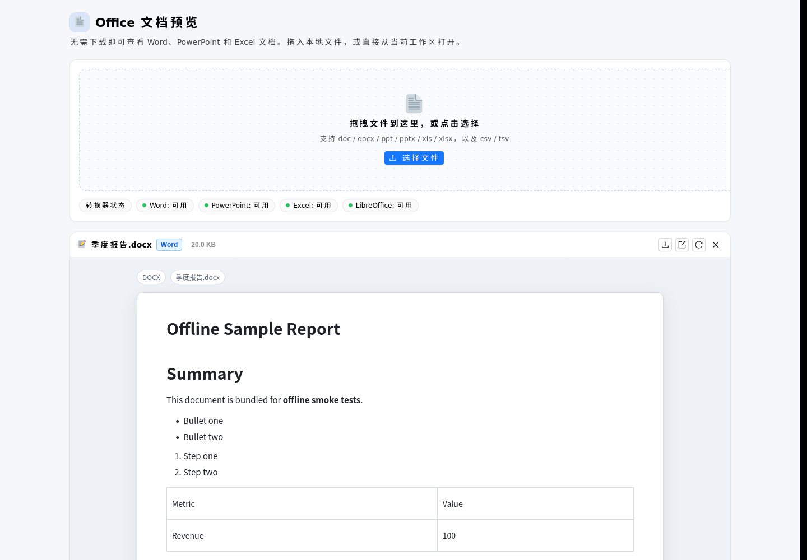
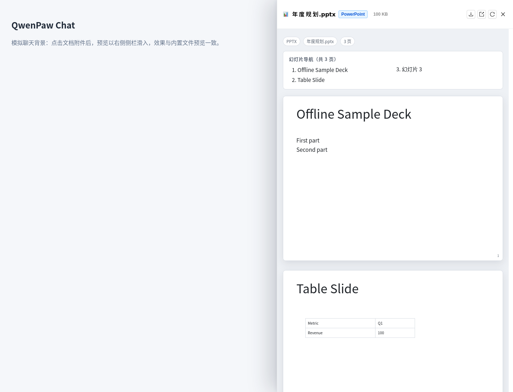
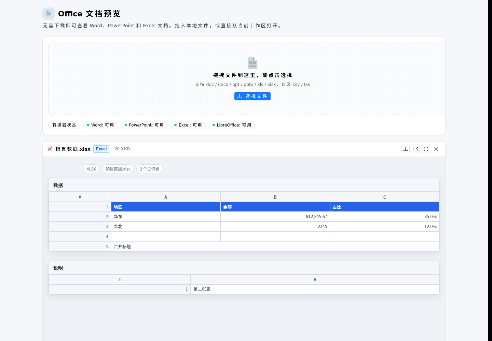

# QwenPaw Office 文档预览插件

[](https://github.com/Ligandlly/qwenpaw-office-preview/actions/workflows/offline-package.yml)
[](LICENSE)

给 [QwenPaw](https://github.com/modelscope/QwenPaw) 增加 Word / PowerPoint / Excel
文档预览能力。QwenPaw 原生只能预览纯文本、图片、PDF 和 CSV；安装本插件后，聊天里
生成的 `.docx` / `.pptx` / `.xlsx` 附件、工作区里的办公文档以及本地拖入的文件都可
以直接在浏览器中查看，无需下载再用 Office 打开。

- 后端把办公文档转换成**自包含 HTML**（内联 CSS + data-URI 图片），前端用
  `<iframe sandbox="">` 展示，不加载任何外部资源，也不执行文档里的脚本。
- 支持现代 OOXML 格式（原生解析）和旧版二进制格式（检测到本机 LibreOffice 时自动
  转换后解析）。
- 聊天中点击办公文档会打开**右侧滑入侧栏**，与 QwenPaw 内置文件预览一致：不遮挡
  对话、可拖拽左边缘调整宽度、双击恢复默认宽度；其他文件类型仍交给内置预览。
- 同时提供独立预览页面、拖拽上传和工作区文件浏览。

<p align="center">
  
  
  
</p>

## 支持的格式

| 格式 | 渲染方式 | 说明 |
| --- | --- | --- |
| `.docx` `.docm` `.dotx` | `mammoth` + `python-docx` 兜底 | 标题、列表、表格、内联图片、超链接 |
| `.doc` `.dot` `.wps` | LibreOffice → `.docx` | 需要本机安装 LibreOffice |
| `.pptx` `.pptm` `.ppsx` `.potx` | `python-pptx`，缺失时用内置纯 Python 解析器 | 按幻灯片真实比例自适应侧栏宽度；文本、表格、图片、图表数据表、演讲者备注 |
| `.ppt` `.pps` `.dps` | LibreOffice → `.pptx` | 需要本机安装 LibreOffice |
| `.xlsx` `.xlsm` `.xltx` `.xltm` | `openpyxl` | 多工作表、合并单元格、常见数字/日期/百分比/货币格式、基础字体与底色 |
| `.xls` `.et` | LibreOffice → `.xlsx` | 需要本机安装 LibreOffice |
| `.csv` `.tsv` | 内置解析 | 自动猜测分隔符，补充 QwenPaw 原生 CSV 预览之外的编码（GB18030 等） |

文件扩展名与实际内容不一致时会按**文件头签名**判断（例如后缀是 `.doc`、内容其实是
`.docx` 的文件不会被误送去 LibreOffice）。

## 离线安装（内网 / 无外网）

推荐使用 GitHub Actions 打出的离线包：

- 推送 `v*` tag 时自动发布到 [Releases](https://github.com/Ligandlly/qwenpaw-office-preview/releases)；
- 手动运行 **Build, Test & Package** 工作流，从 Actions 的 `offline-bundle` 产物下载。

包内已包含构建好的前端 bundle 和纯 Python 依赖（`mammoth` / `openpyxl` 及其依赖），
安装时**不需要 pip、npm 或任何网络访问**：

```bash
qwenpaw plugin install ./qwenpaw-office-preview-offline-1.1.0.zip
```

解压后也可以直接安装目录：

```bash
unzip qwenpaw-office-preview-offline-1.1.0.zip
qwenpaw plugin install ./qwenpaw-office-preview
```

离线包使用内置纯 Python PPT 解析器，因此不携带 `python-pptx` / `lxml`；详细说明见
下载包内的 `OFFLINE-INSTALL.md`。自己打包：

```bash
cd frontend
npm ci --legacy-peer-deps
npm run build
cd ..

python3 scripts/package_offline.py --out-dir dist-offline
python3 scripts/smoke_offline.py dist-offline/.staging/qwenpaw-office-preview
```

## 联网安装（源码目录）

```bash
# 方式一：从本地目录安装（会检查并在需要时安装 Python 依赖）
qwenpaw plugin install /path/to/qwenpaw-preview-plugin

# 方式二：直接拷进插件目录后重启
cp -r qwenpaw-preview-plugin ~/.qwenpaw/plugins/
qwenpaw restart
```

联网版在 `requirements.txt` 中声明以下依赖，QwenPaw 在显式安装/更新/修复插件时会
安装缺失项：

```
mammoth>=1.8.0
python-docx>=1.1.2   # Word 兜底渲染（可选）
python-pptx>=1.0.2   # 更高保真的 PPT 渲染（可选）
openpyxl>=3.1.2
```

`python-pptx` / `python-docx` 缺失时插件仍可工作：PPT 自动切换到内置解析器，
DOCX 使用 `mammoth`。手动安装完整依赖：

```bash
pip install -r requirements.txt
# 或让 QwenPaw 修复插件依赖
curl -X POST http://127.0.0.1:8000/api/plugins/qwenpaw-office-preview/repair-dependencies
```

安装完成后侧边栏 **设置 → 插件 → Office 预览** 会出现入口，也可以直接访问
`/plugin/qwenpaw-office-preview`。插件页面顶部会显示各转换器的可用状态。

### 旧版 `.doc` / `.ppt` / `.xls`

这三类文件是 OLE2 二进制格式，纯 Python 解析不可靠。插件会依次查找：

1. 环境变量 `QWENPAW_OFFICE_PREVIEW_SOFFICE` 指定的可执行文件；
2. `PATH` 中的 `soffice` / `libreoffice`；
3. Linux/macOS/Windows 的常见安装路径。

```bash
# Debian / Ubuntu
sudo apt install libreoffice-core libreoffice-writer libreoffice-calc libreoffice-impress

# macOS
brew install --cask libreoffice
```

没有 LibreOffice 时，旧格式会返回明确提示而不是空白页；新格式（docx/pptx/xlsx）
不受影响。

## 使用

### 1. 聊天中的文件

在对话里点击由 `read_file` / `write_file` / 发送文件等工具产生的办公文档链接时，
插件拦截 `qwenpaw:open-file-preview` 事件，并从右侧滑入与内置预览同款的侧栏：

- 左边缘可拖拽调整宽度（宽度会记住，双击复位）；
- `Esc`、关闭按钮或点击侧栏外部即可关闭；
- 文本 / 图片 / PDF / CSV 等宿主已支持的类型仍由内置预览处理。

### 2. 独立预览页

页面内点击工作区文档会直接展开预览；聊天场景使用右侧侧栏，二者共用同一个
`OfficeViewer` 组件。

- **拖拽 / 选择本地文件**：文件字节经认证接口上传给插件后端转换，不落盘。
- **工作区文件**：在“项目目录 / 工作区目录”之间切换，浏览目录并点击办公文档。
- **URL 直达**：

  ```
  /plugin/qwenpaw-office-preview?path=docs/报告.docx&root=project
  /plugin/qwenpaw-office-preview?artifact=/api/files/preview/home/u/a.pptx&name=a.pptx
  ```

### 3. 其他插件或脚本调用

```js
window.QwenPawOfficePreview.open({ path: "docs/季度报告.docx", root: "project" });
// 或直接派发宿主事件
window.dispatchEvent(new CustomEvent("qwenpaw:open-file-preview", {
  detail: { target: { source: "workspace", path: "docs/季度报告.docx", root: "project" } },
}));
```

## HTTP 接口

后端通过 QwenPaw 插件路由挂载在 `/api/office-preview`：

| 方法 | 路径 | 说明 |
| --- | --- | --- |
| `GET` | `/health` | 转换器 / LibreOffice 可用状态、大小限制 |
| `POST` | `/convert?filename=x.docx&theme=dark` | 请求体为原始文件字节，返回 `{html, warnings, meta}` |
| `POST` | `/convert-upload?theme=auto` | multipart 上传（`file` 字段），便于脚本调用 |

```bash
curl -s http://127.0.0.1:8000/api/office-preview/health | jq
curl -s -X POST \
  -H 'Content-Type: application/octet-stream' \
  --data-binary @report.docx \
  "http://127.0.0.1:8000/api/office-preview/convert?filename=report.docx" | jq -r .html > preview.html
```

错误统一返回 `{"detail": {"code": "...", "message": "..."}}`：

| 状态码 | code | 含义 |
| --- | --- | --- |
| 413 | `file_too_large` | 超过大小上限 |
| 415 | `unsupported_format` | 扩展名不支持 |
| 422 | `invalid_document` / `invalid_*` | 文件损坏、加密或渲染失败 |
| 501 | `legacy_converter_missing` | 旧格式但未安装 LibreOffice |

## 配置

| 环境变量 | 默认值 | 说明 |
| --- | --- | --- |
| `QWENPAW_OFFICE_PREVIEW_MAX_MB` | `40` | 单个文件大小上限（MB），前后端都会检查 |
| `QWENPAW_OFFICE_PREVIEW_SOFFICE` | 自动探测 | 指定 LibreOffice 可执行文件路径 |

转换结果按 `sha256 + 主题 + 文件名` 缓存在内存中（最多 16 份），重复打开同一文件
会明显更快。重启 QwenPaw 或重新加载插件后缓存清空。

## 安全设计

- 插件不接收工作区路径，也不直接读宿主文件系统。前端先用 QwenPaw 自己的认证接口
  取回字节，再 POST 给插件转换，因此工作区权限仍由宿主控制。
- 所有 HTML 在 `<iframe sandbox="">` 中渲染：脚本被禁用，不能导航顶层页面，也不能
  发起表单提交。
- `mammoth` 输出会经过白名单 HTML 清洗：只保留有限标签/属性，`href` 仅允许
  `http/https/mailto`，图片仅允许 `data:image/*`，`style` 仅保留安全的排版属性。
- 上传大小有服务端硬限制；Office 压缩包会检查解压后体积和压缩比，防御 zip bomb；
  Excel 行/列/工作表数量均有上限，避免超大文件拖垮进程。
- 转换在 FastAPI 线程池中执行，不阻塞事件循环；LibreOffice 子进程有 180 秒超时和
  独立临时 profile。

## 已知限制

- PPT 是“高保真近似”：文本框自动缩放、SmartArt、动画、音视频、OLE 对象不会渲染；
  图表以数据表形式展示。分组形状会按组合坐标变换渲染。联网安装时优先使用
  `python-pptx`；离线包使用内置解析器，复杂继承样式可能进一步简化。
- Word 的浮动图片、文本框、脚注、批注、复杂域代码不保证完整呈现；以 `mammoth` 的
  语义化结果为准。
- Excel 仅展示缓存值（公式无缓存值时显示公式本身），不计算公式、不渲染图表和条件
  格式；每个工作表最多 400 行 × 60 列，最多 30 个工作表。
- 加密（带密码）的文档无法预览。
- 聊天中来自“会话级自定义项目目录”的工作区文件可能因缺少 `X-Chat-Id` 而无法定位；
  这类文件通常会以附件 URL 形式出现，仍可正常预览。
- 插件只读预览，不提供编辑、保存或另存为。

## 开发

后端（Python ≥ 3.10，后端测试当前 27 个用例）：

```bash
python -m venv .venv && source .venv/bin/activate
pip install -r requirements.txt fastapi httpx pytest python-multipart
python -m pytest -q
ruff check .
```

前端（Node ≥ 18，17 个 Vitest 用例）：

```bash
cd frontend
npm ci --legacy-peer-deps
npm run typecheck   # tsc
npm run test        # vitest + jsdom
npm run build       # 产出 ../dist/index.js（无外部 import，React/antd 由宿主注入）
```

离线包：

```bash
python3 scripts/package_offline.py --out-dir dist-offline
python3 scripts/smoke_offline.py dist-offline/.staging/qwenpaw-office-preview
```

整体校验：

```bash
qwenpaw plugin validate .
```

目录结构：

```
qwenpaw-preview-plugin/
├── .github/workflows/     # CI：测试 + 前端构建 + 离线包 + Release
├── plugin.json            # 插件清单（backend + frontend 入口、依赖、版本约束）
├── plugin.py              # 注册 /api/office-preview 路由
├── converter/             # 转换器（docx/pptx/xlsx/csv/legacy、纯 Python PPT、清洗、缓存）
├── dist/index.js          # 已构建的前端 bundle
├── frontend/              # 前端源码（esbuild + TypeScript + Vitest）
├── packaging/             # 离线安装说明模板
├── scripts/               # 离线打包与冒烟测试
├── requirements.txt       # 联网安装依赖
├── requirements-offline.txt  # 离线包纯 Python 依赖
├── tests/                 # 后端 pytest + 固定样例文档
└── docs/                  # 截图
```

## 卸载

```bash
qwenpaw plugin uninstall qwenpaw-office-preview
```

卸载后聊天文件点击会回到 QwenPaw 原生行为（办公文档显示“无法预览”），前端路由和
拦截器会随插件清理自动移除。

## English summary

A QwenPaw plugin that previews Word, PowerPoint and Excel documents
(`doc/docx/ppt/pptx/xls/xlsx`, plus csv/tsv). The backend converts documents to
self-contained HTML (inline CSS and data-URI images) and the frontend renders it
in a sandboxed iframe. Legacy binary formats are converted through LibreOffice
when available. Chat file links open a right-side drawer that mirrors the
built-in file preview (resizable width, click-outside/Esc to close), and a
dedicated preview page supports drag & drop plus workspace browsing.

For offline machines, download the `qwenpaw-office-preview-offline-*.zip`
artifact/release and run `qwenpaw plugin install <zip>`; it vendors the
pure-Python dependencies and needs no network. See the sections above for
configuration, API, development and limitations.
